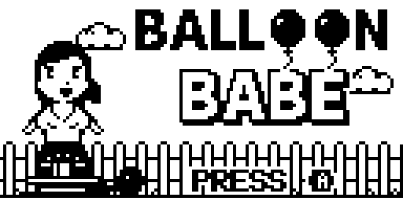
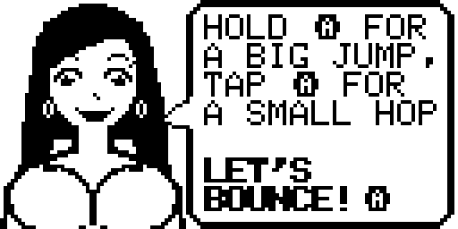
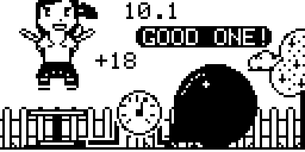
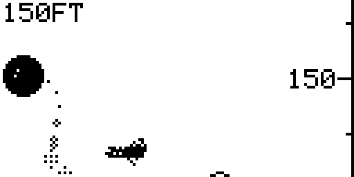
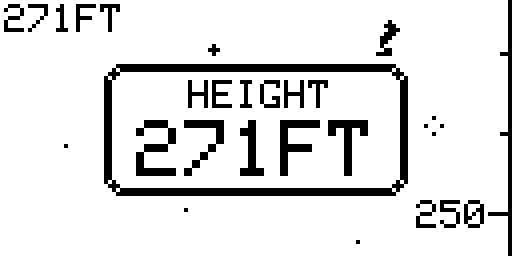
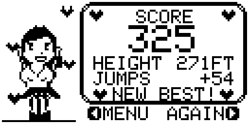

# Balloon Babe


Help her pump up her balloon! She jumps on a long-stroke foot pump: every landing rides the plate down
and pushes air into the balloon. Time each jump for the moment the pump bottoms out, because timing is
everything. After 11 seconds the balloon slips off the nozzle and leaks its way up into the sky, past the
clouds, the birds and the planes, into the stars. How high can you get it?

By **jaychugstein** · MIT License · **Arduboy FX / FX-C** and **POOM** (uses the FX flash chip).

**Play it in your browser:** https://jaychugstein.github.io/Balloon-Babe/ (works on phones too)

 
 
 


## Controls

A and B do exactly the same thing everywhere, so it doesn't matter how your device maps them.

| Button | What it does |
|---|---|
| A or B (hold) | A big, full-height jump |
| A or B (tap) | A small hop |
| A or B | Start · next screen · show the whole speech bubble / turn the page |
| Up / Down | Sound on or off (sound screen) |
| Right (or A / B) | Play again (score screen) |
| Left | Back to the title (score screen) |

## How a round works

- After the title comes the sound screen, then she explains how to play in two speech bubbles.
- 3, 2, 1, JUMP! She starts standing on the pump, pushed all the way down.
- Each landing rides the plate down under her weight, pushing air into the balloon the whole way
  (a full stroke). A big held jump gives the plate time to spring all the way back up; a little hop lands on
  it halfway, for a shorter stroke and less air. Every landing adds at least a little air.
- Jump again right as the plate bottoms out. On-the-beat jumps in a row push more air per stroke.
- The gauge on the hose shows how full the balloon is. It's full only after a near-perfect round.
- After 11 seconds the balloon slips off and flies. A fuller balloon leaks longer and pushes harder, so it
  goes higher: clouds (20-70 ft), birds (70-130 ft), planes (130-190 ft), then twinkling stars.
  Your height is the highest point any part of the balloon reaches, full or empty; when it runs out of air,
  the height is stamped on the screen.

## Scoring

- Every jump scores **5 to 100** points: timing (how close your press was to the moment the plate bottomed
  out, measured to the millisecond, 0 points at 300 ms off) times height (a full, held jump).
  Within about 40 ms with a full jump is a **PERFECT** (with a ding).
- Every jump gets a cheer, one of 30, from PERFECT! and FLAWLESS! down to KEEP GOING! and STAY CUTE!
- **Score = jump points + height in feet.** Your best score is saved.

## Install

Load `release/BalloonBabe.arduboy` with any FX-aware uploader (for example the Arduboy Web Flasher or the
Arduboy-Python-Utilities), or the `.hex` together with `release/BalloonBabe-fxdata.bin`. Add it to an FX
cart image the usual way to play it on an Arduboy FX / FX-C or a POOM.

The game is built with `ARDUBOY_NO_USB` to save space, like most cart games: to upload something else
afterwards, press reset when the uploader asks.

## Building from source

The sketch is in `BalloonBabe/` and needs the **Arduboy2**, **ArduboyFX** and **ArduboyTones** libraries.

* **Arduino IDE:** open `BalloonBabe/BalloonBabe.ino`, pick an Arduboy FX board, compile, then upload
  `BalloonBabe/fxdata/fxdata.bin` as the FX data.
* **Command line:** `./build.sh` (set the library paths at the top) → `build/BalloonBabe.hex`.

All the art is drawn by Python scripts in `art/` (needs numpy, scipy and Pillow; the logo uses the
Noto Sans CJK Black font) and packed into the FX data:

```
cd art
python3 babe2.py && python3 export.py      # her sprite: 6 poses, the bouncing chest, the skirt -> BalloonBabe/sprites.h
python3 portrait.py && python3 logo3.py    # the talking portrait and the title logo
python3 fxpack.py                          # writes BalloonBabe/fxdata/fxdata.bin and BalloonBabe/fxdata.h
```

`BalloonBabe/font.h` is the Arduboy2 5x7 font.

## Browser version

`docs/` is a small web page that runs the real game files in the
[Ardens](https://github.com/tiberiusbrown/Ardens) emulator (MIT, by Peter Brown). It's served by GitHub
Pages from the `docs` folder.

## License

MIT — see [LICENSE](LICENSE). Uses the Arduboy2 (BSD 3-Clause), ArduboyFX (CC0) and ArduboyTones
(BSD 3-Clause) libraries.
